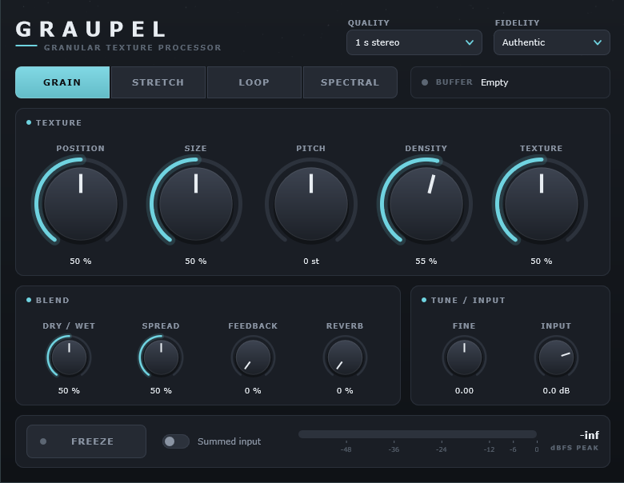

# Graupel

Graupel is a granular texture processor plugin (VST3 and standalone app). It is
based on the **Clouds** texture synthesizer by Émilie Gillet, from
[Mutable Instruments' open-source Eurorack firmware](https://github.com/pichenettes/eurorack).

Graupel keeps a short recording of its own input, the Recording Buffer, and
breaks it into grains, stretched slices, loops or spectral frames before putting
it back together. It is an audio effect, not an instrument: there is no MIDI,
CV, transport, file loading or tempo sync.



## Features

- Four playback modes: Grain, Stretch, Loop and Spectral
- Recording Buffer of 1 s stereo, 2 s mono, 4 s stereo or 8 s mono
- Authentic fidelity (32 kHz, 8-bit storage at the longer settings, like the
  hardware) or HQ (host sample rate, 16-bit storage)
- Freeze to hold the recording and keep playing with it
- Feedback, stereo spread and a built-in reverb
- Input gain, summed mono input, a peak meter and a buffer status display
- Switching between modes keeps the recording
- All controls are automatable and saved with the host project

## Modes

| Mode | Description |
|---|---|
| Grain | Plays many short, overlapping grains taken from the buffer: from sparse clicks to dense, smeared clouds. |
| Stretch | Time-stretches and pitch-shifts the buffer by splicing overlapping slices. Smoother than Grain; good for slowed-down or frozen pads. |
| Loop | A looping delay. While capturing it is a delay with a pitch shifter. When Frozen it loops a slice of the buffer set by Position and Size. |
| Spectral | Works on the frequency spectrum (phase vocoder). Spectral frames can be blurred, quantized, warped and frozen for glassy or robotic textures. |

Switching between Grain, Stretch and Loop keeps the recording. Switching into
Spectral and back restores the recording you had before.

## Controls

Double-click a knob to reset it, or double-click its value to type a number.
Hover over a control to see a short description.

### Texture

Several of the five large knobs do something different in each mode.

| Control | Grain | Stretch | Loop | Spectral |
|---|---|---|---|---|
| Position | How far back in the buffer grains start. | Playback point in the buffer. | Delay time; loop start when Frozen. | Which stored spectral frame is played. |
| Size | Grain length, from tiny clicks to long grains. | Length of the stretched slices. | Pitch shifter window; loop length when Frozen. | Frequency warp. The centre is neutral. |
| Pitch | Transposes the grains (±48 semitones). | Changes pitch without changing speed. | Pitch shifter; loop playback speed when Frozen. | Shifts the spectrum. |
| Density | Grain rate (see below). | Diffusion (smearing). | Diffusion (smearing). | Spectrum refresh rate. Away from the centre it also randomises phases. |
| Texture | Grain envelope, from hard-edged to smooth up to about 75 %; above that it adds diffusion. | Filter: below 50 % a low-pass closes, above 50 % a high-pass opens. | Filter, as in Stretch. | Quantizes the spectrum for coarser, more digital sounds. |

In Grain mode, Density makes no new grains at the centre (about 47–53 %).
Turning left gives grains at a steady rate that gets faster towards 0 %; turning
right gives grains at random times, more of them towards 100 %.

### Blend, tune and input

| Control | Description |
|---|---|
| Dry / Wet | Equal-power crossfade between the input and the effect. |
| Spread | Places each grain at a random position in the stereo field. Grain mode only. |
| Feedback | Feeds the effect output back into the recording for layered, evolving textures. A low-cut filter stops low-frequency build-up. While Frozen nothing new is recorded, so Feedback lengthens the reverb tail instead. |
| Reverb | Built-in reverb; higher settings increase both amount and decay time. The reverb is not fed back into the recording. |
| Fine | Fine pitch offset of ±1 semitone, added to Pitch. |
| Input | Gain before recording, −18 to +6 dB. Signals near full scale are soft-clipped, as on the hardware. |

### Buffer and output

| Control | Description |
|---|---|
| Mode | Grain, Stretch, Loop or Spectral (the buttons under the title). |
| Quality | Length and channels of the Recording Buffer: 1 s stereo, 2 s mono, 4 s stereo or 8 s mono. |
| Fidelity | Authentic follows the hardware signal path at 32 kHz; the 4 s and 8 s settings use 8-bit storage, which adds grit. HQ runs at the host sample rate with 16-bit storage. Fidelity never changes the buffer length. |
| Freeze | Holds the Recording Buffer; no new input is recorded while it is on. |
| Summed input | Mixes left and right to mono before recording. It does not change Quality or the buffer length. |
| Buffer | Shows *Empty*, *Capturing input* or *Frozen / output*. |
| Meter | Peak level in dBFS: the input while capturing, the output while Frozen. |

## Building

Requirements: CMake 3.22 or newer and a C++20 compiler (developed with Visual
Studio 2026 on Windows). JUCE 9.0.5 is fetched with CMake FetchContent, so the
first configure needs network access. The Clouds DSP comes from a Git
submodule, so clone with `--recursive`.

```powershell
git clone --recursive https://github.com/duddex/graupel.git
cd graupel
cmake -S . -B build
cmake --build build --config Release
ctest --test-dir build -C Release --output-on-failure
```

Build output:

- VST3: `build/Graupel_artefacts/Release/VST3/Graupel.vst3`
- Standalone: `build/Graupel_artefacts/Release/Standalone/Graupel.exe`

To use the VST3, copy the `Graupel.vst3` folder to `C:\Program Files\Common Files\VST3`.

The DSP tests need no plugin host; `ctest` runs them. To validate the VST3 with
[pluginval](https://github.com/Tracktion/pluginval/releases):

```powershell
pluginval.exe --strictness-level 8 --skip-gui-tests `
  --validate build\Graupel_artefacts\Release\VST3\Graupel.vst3
```

Design decisions are recorded in [`docs/adr/`](docs/adr/).

## Releases

GitHub Actions builds, tests and validates every push on Windows, and uploads a
zip of the VST3, the standalone app and the licence files as a build artifact.

## Licence

Graupel is free software, licensed under the GNU Affero General Public License,
version 3. See [`LICENSE`](LICENSE).

Graupel is based on MIT-licensed code by Émilie Gillet
([`licenses/Clouds-MIT.txt`](licenses/Clouds-MIT.txt)). It uses JUCE under the
AGPLv3. See [`NOTICE`](NOTICE) for all copyright notices and third-party
licences.

Graupel is not an official Mutable Instruments product and is not affiliated
with or endorsed by Mutable Instruments or Émilie Gillet. "Mutable Instruments"
is a registered trademark of its owner.

## Credits

Designed and developed by [duddex](https://github.com/duddex) with the help of a
large language model (LLM).

Graupel is based on the Clouds module by Émilie Gillet (Mutable Instruments).
Its DSP is built unmodified from the
[pichenettes/eurorack](https://github.com/pichenettes/eurorack) repository.
Built on the [JUCE](https://juce.com) framework.
